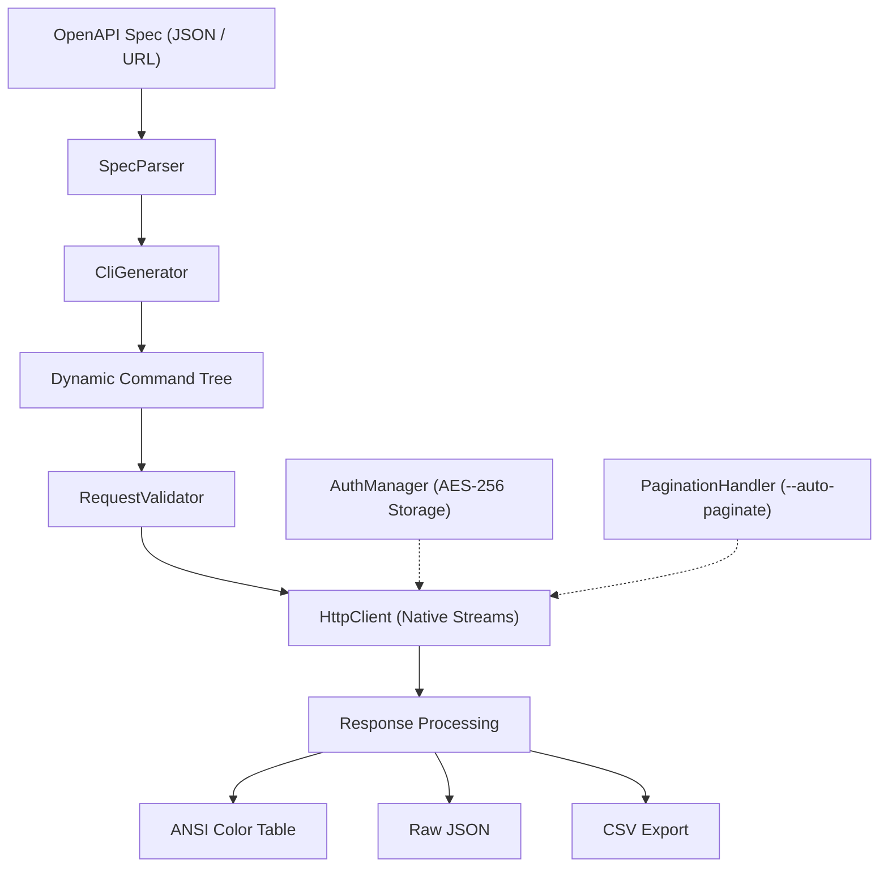

[🇸🇦 العربية](README.ar.md) | [🇬🇧 English](README.md)

# 💻 eidcloud-api-cli

> Universal OpenAPI specification to interactive CLI generator with pagination, auth, and table outputs in pure PHP 8.2+.

[](https://github.com/eidcloud/eidcloud-api-cli/releases)
[](https://www.php.net/)
[](https://opensource.org/licenses/MIT)
[](https://github.com/eidcloud/eidcloud-api-cli/actions)
[](https://colab.research.google.com/github/eidcloud/eidcloud-api-cli/blob/main/notebooks/quickstart.ipynb)

---

## 🌟 Overview

**`eidcloud-api-cli`** ingests any OpenAPI 3.0 / 3.1 or Swagger 2.0 specification and generates an interactive, high-performance command-line interface. Built with **pure PHP 8.2+ with zero external vendor dependencies**, it delivers instant command trees, encrypted local authentication management, automated pagination, input validation, ANSI box table rendering, and shell auto-completion.



---

## 🚀 Key Capabilities

- **Zero External Dependencies**: 100% native PHP 8.2+ using native stream wrappers and OpenSSL encryption.
- **Dynamic Command Synthesis**: Maps REST paths to human-friendly subcommands:
  - `api users list`
  - `api users get --id=10`
  - `api users create --body='{"name": "Shadi"}'`
- **Interactive Authentication Management**:
  - Encrypted local profile storage with AES-256-CBC.
  - Supports Bearer tokens, API Keys (header or query), and HTTP Basic Auth.
- **Built-in Parameter Validation**:
  - Enforces required path, query, and header parameters with type coercion (integer, boolean, string, array, enum).
- **Automated Pagination Engine**:
  - Traverses cursor and page/offset APIs seamlessly using `--auto-paginate`, `--page`, and `--limit`.
- **Rich Output Formatting**:
  - Clean ANSI unicode box tables (`--table`).
  - Standard JSON output for piping into `jq` (`--json`).
  - CSV export for spreadsheets and data processing (`--csv`).
- **Shell Auto-Completion**:
  - Generates ready-to-use completion scripts for **Bash** and **Zsh**.

---

## 📦 Installation

Clone the repository or install via Composer:

```bash
git clone https://github.com/eidcloud/eidcloud-api-cli.git
cd eidcloud-api-cli
```

Make the binary executable:

```bash
chmod +x bin/eidcloud-api-cli
```

---

## 💡 Usage Guide

### 1. Inspect Spec & Help
```bash
php bin/eidcloud-api-cli --help
```

### 2. Generate a Standalone CLI Executable
Turn any OpenAPI specification into a standalone CLI executable tool:

```bash
php bin/eidcloud-api-cli generate examples/sample-openapi.json --name=myapi --out=./bin
```

Now use your generated tool:
```bash
php bin/myapi.php --help
php bin/myapi.php users list --limit=5 --table
php bin/myapi.php users get --id=1 --table
```

### 3. Direct One-Liner Endpoint Invocations (`call`)
Invoke any endpoint directly from an OpenAPI specification without compiling:

```bash
# Render as ANSI table
php bin/eidcloud-api-cli call examples/sample-openapi.json /users GET --table

# Render specific user as JSON
php bin/eidcloud-api-cli call examples/sample-openapi.json /users/1 GET --json

# Export posts as CSV
php bin/eidcloud-api-cli call examples/sample-openapi.json /posts GET --limit=10 --csv
```

### 4. Authentication Management
Store and switch between credential profiles securely:

```bash
# Store Bearer Token
php bin/eidcloud-api-cli auth set prod --type=bearer --token=your_jwt_token_here

# Store API Key
php bin/eidcloud-api-cli auth set staging --type=apikey --name=X-API-Key --value=secret_key --in=header

# List configured profiles
php bin/eidcloud-api-cli auth list

# Execute with saved profile
php bin/eidcloud-api-cli call openapi.json /protected GET --profile=prod --table
```

### 5. Shell Auto-Completion
Generate completion scripts for your shell:

```bash
# Bash
php bin/eidcloud-api-cli completion bash > /etc/bash_completion.d/eidcloud-api-cli

# Zsh
php bin/eidcloud-api-cli completion zsh > ~/.zsh/completion/_eidcloud-api-cli
```

---

## 🧪 Testing & Verification

Run the automated test runner (zero external testing dependencies required):

```bash
php tests/run_tests.php
```

All tests for spec parsing, parameter validation, ANSI table formatting, encrypted authentication, and CLI compilation are executed.

---

## 📓 Interactive Quickstart (Google Colab)

Try `eidcloud-api-cli` directly in your browser without local setup:

[](https://colab.research.google.com/github/eidcloud/eidcloud-api-cli/blob/main/notebooks/quickstart.ipynb)

---

## 👤 Author & Maintainer

**Eng. MHD. Shadi AL-Hasan**  
- **Role:** Executive CTO & Enterprise Solutions Architect  
- **Email:** [mhd.shadi.alhasan@gmail.com](mailto:mhd.shadi.alhasan@gmail.com)  
- **Phone / WhatsApp:** [+963934005922](tel:+963934005922)  
- **Location:** Damascus, Syria  
- **GitHub:** [shadialhasan](https://github.com/shadialhasan)  

---

## 📄 License

This project is licensed under the MIT License - see the [LICENSE](LICENSE) file for details.  
Copyright (c) 2026 **MHD. Shadi AL-Hasan**. All rights reserved.
